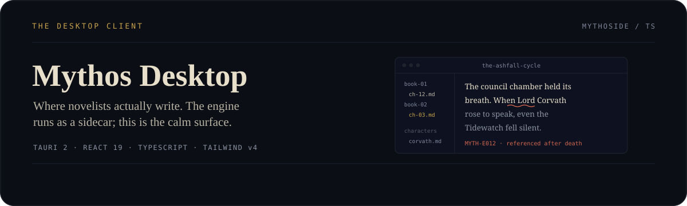

<p align="center">
  
</p>

<p align="center">
  <a href="https://github.com/mythoside">Mythos</a> · <a href="https://github.com/mythoside/mythoside-core">Motor</a> · <a href="https://mythoside.com">mythoside.com</a> · <a href="./README.md">English</a> · Türkçe
</p>

<p align="center">
  <a href="./LICENSE.md"></a>
</p>

[Mythos](https://github.com/mythoside)'un masaüstü uygulaması, yazdığın yer. Bir seriyi kitaplar ve bölümlerden oluşan bir ağaç olarak gösterir, her bölüm için bir editör açar ve karakterler, mekânlar ve zaman çizelgesi notları için sayfaları bunların yanında tutar. Bir karakterin sayfası, o karakterin geçtiği bölümleri listeler.

Uygulama dosyalarına kendisi dokunmaz. [`mythoside-core`](https://github.com/mythoside/mythoside-core) motorunu bir sidecar süreci olarak başlatır ve her şeyi ondan stdin/stdout üzerinden ister.

> **Erken geliştirme aşamasında.** Arayüz yeniden yapılıyor; ekranlar ve davranışlar değişecek.

## Parçalar nasıl birleşiyor

```text
mythoside-ts (bu repo)                mythoside-core (sidecar)
React arayüzü  →  Tauri komutları  ── stdio, mesaj başına tek JSON satırı ──>  Rust motoru
                                                                                 │
                                                          Diskindeki Markdown + YAML dosyaları
```

## Çalıştır

Node.js, npm, Rust ve platformun için [Tauri gereksinimleri](https://tauri.app/start/prerequisites/) gerekir.

```bash
git clone https://github.com/mythoside/mythoside-ts.git
cd mythoside-ts
npm install
npm run tauri dev
```

İlk çalıştırmada `mythoside-core` klonlanıp derlenir (bkz. `scripts/prepare-sidecar.mjs`), bu yüzden birkaç dakika sürer.

## Teknolojiler

| Katman | Araç |
| --- | --- |
| Kabuk | Tauri 2 |
| Arayüz | React 19, TypeScript, Zustand |
| Editör | BlockNote |
| Derleme | Vite+ |
| Motor | Sidecar binary'si olarak paketlenen `mythoside-core` |

## Klasör yapısı

```text
src/views/          her ekran için bir görünüm: seri, kitaplar, bölümler, karakterler, mekânlar, zaman çizelgesi
src/state/          seri deposu ve gezinme
src/lib/            editör şeması, karakter geçişleri, tema
src-tauri/src/      Tauri komutları ve motorla konuşan istemci
scripts/            prepare-sidecar.mjs, Tauri için motor binary'sini derler
```

## Fiyat

Geliştirme süresince ücretsiz. 1.0 sürümüyle birlikte Mythos, bir yıllık güncellemeyi içeren tek seferlik bir satın alma olacak. Satın aldığın sürüm sonrasında da çalışmaya devam eder; yenilemek isteğe bağlı. Bu repodan kendin derlemek ücretsiz kalır.

## Lisans

[Functional Source License 1.1, ALv2 Future License](./LICENSE.md) ile kaynak kodu erişilebilir. Kullanabilir, okuyabilir, değiştirebilir ve kendi bilgisayarında barındırabilirsin. Rakip bir ticari ürün ya da hizmet olarak sunamazsın. Her sürüm yayımlandıktan iki yıl sonra Apache 2.0'a dönüşür. Mythos adı ve logosu lisansın kapsamında değildir.

[Katkı](https://github.com/mythoside/.github/blob/main/CONTRIBUTING.md) · [Güvenlik](https://github.com/mythoside/.github/blob/main/SECURITY.md) · [Discussions](https://github.com/mythoside/mythoside-core/discussions)
