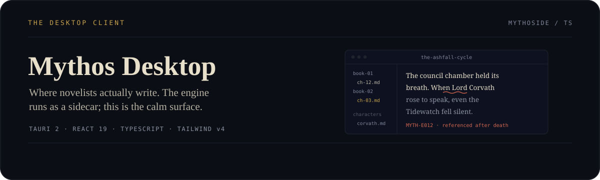

<p align="center">
  
</p>

<p align="center">
  <a href="https://github.com/mythoside">Mythos</a> · <a href="https://github.com/mythoside/mythoside-core">Engine</a> · <a href="https://mythoside.com">mythoside.com</a> · English · <a href="./README.TR.md">Türkçe</a>
</p>

<p align="center">
  <a href="./LICENSE.md"></a>
</p>

The desktop app for [Mythos](https://github.com/mythoside), where you write. It shows a series as a tree of books and chapters, gives you an editor for each chapter, and keeps pages for characters, locations and timeline notes next to them. A character's page lists the chapters that mention them.

The app doesn't touch your files itself. It starts the [`mythoside-core`](https://github.com/mythoside/mythoside-core) engine as a sidecar process and asks it for everything over stdin and stdout.

> **Early development.** The interface is being rebuilt, so screens and behaviour will change.

## How it fits together

```text
mythoside-ts (this repo)              mythoside-core (sidecar)
React UI  →  Tauri commands  ── stdio, one JSON line per message ──>  Rust engine
                                                                        │
                                                       Markdown + YAML files on your disk
```

## Run it

You need Node.js, npm, Rust and the [Tauri prerequisites](https://tauri.app/start/prerequisites/) for your platform.

```bash
git clone https://github.com/mythoside/mythoside-ts.git
cd mythoside-ts
npm install
npm run tauri dev
```

The first run clones and builds `mythoside-core` (see `scripts/prepare-sidecar.mjs`), so it takes a few minutes.

## Stack

| Layer | Tooling |
| --- | --- |
| Shell | Tauri 2 |
| UI | React 19, TypeScript, Zustand |
| Editor | BlockNote |
| Build | Vite+ |
| Engine | `mythoside-core`, bundled as a sidecar binary |

## Layout

```text
src/views/          one view per screen: series, books, chapters, characters, locations, timeline
src/state/          series store and navigation
src/lib/            editor schema, character mentions, theme
src-tauri/src/      Tauri commands and the client that talks to the engine
scripts/            prepare-sidecar.mjs builds the engine binary for Tauri
```

## Pricing

Free while in development. From version 1.0, Mythos is a one-time purchase that includes a year of updates. The version you bought keeps working after that, and renewing is optional. Building it yourself from this repository stays free.

## License

Source-available under the [Functional Source License 1.1, ALv2 Future License](./LICENSE.md). You can use, read, modify and self-host it. You can't offer it as a competing commercial product or service. Each release becomes Apache 2.0 two years after it ships. The Mythos name and logo are not covered by the license.

[Contributing](https://github.com/mythoside/.github/blob/main/CONTRIBUTING.md) · [Security](https://github.com/mythoside/.github/blob/main/SECURITY.md) · [Discussions](https://github.com/mythoside/mythoside-core/discussions)
